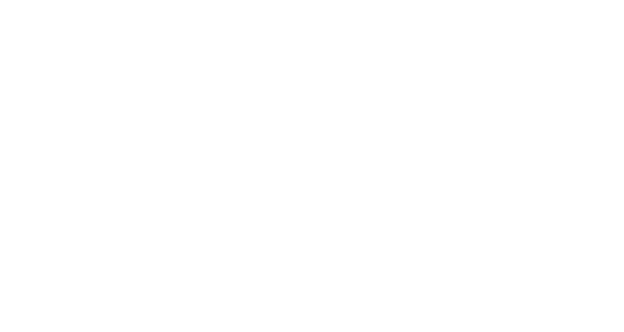
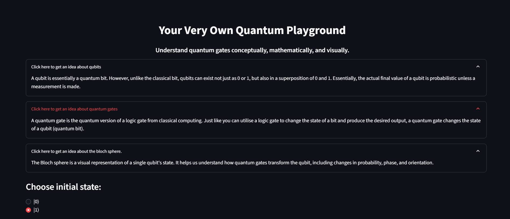

# Quantum Gates Playground

**An interactive, single-qubit learning tool for understanding quantum gates through circuits, linear algebra, and Bloch-sphere visualizations.**

Built with **Python, Streamlit, Qiskit, NumPy, and Matplotlib**.

## Demo



## Why I built this

Quantum gates can sound abstract until you see what they do to a state vector. I built this project as a beginner-friendly way to connect three descriptions of the same operation: a quantum circuit, a matrix transformation, and a point on the Bloch sphere.

The goal is educational, not to offer a full quantum-computing IDE or a new simulator.

## What you can explore

- Choose a computational-basis initial state: **|0⟩** or **|1⟩**.
- Apply one of six gates: **H, X, Y, Z, S, or T**.
- View the corresponding single-qubit circuit and an explanation of the selected gate.
- Inspect the gate matrix and the resulting state-vector calculation.
- See the resulting state on the Bloch sphere.

**Try it:** Select **|0⟩**, choose the **Hadamard (H)** gate, and click **Apply Gate**. The matrix multiplication gives

$$
H|0\rangle = \frac{|0\rangle + |1\rangle}{\sqrt{2}}.
$$

The Bloch-sphere view illustrates the corresponding change from a basis state to a superposition.

**A useful subtlety:** With only |0⟩ and |1⟩ as initial states, phase gates such as Z, S, and T may leave the Bloch-sphere point visually unchanged. On these inputs they change only an overall phase, which is not observable in the Bloch-sphere representation. Their relative-phase effects become more apparent on superposition states.

## Run locally

```bash
git clone https://github.com/SafuraKasu/quantum_gates_playground.git
cd quantum_gates_playground
python -m venv .venv
```

Activate your environment:

**Windows (PowerShell):**

```powershell
.venv\Scripts\Activate.ps1
```

**macOS / Linux:**

```bash
source .venv/bin/activate
```

Install dependencies and launch the app:

```bash
python -m pip install -r requirements.txt
python -m streamlit run app.py
```

Streamlit will display a local URL for the app. The repository includes pinned dependencies; a clean installation across operating systems has not yet been independently verified.

## How it works

The app builds a **single-qubit `QuantumCircuit`** using Qiskit. Based on the selected input and gate, it displays:

1. **Circuit:** The selected gate is applied to a newly constructed one-qubit circuit.
2. **Linear algebra:** The relevant 2×2 gate matrix multiplies the selected basis-state vector, and the result is rendered in mathematical notation.
3. **Visualization:** Qiskit's `Statevector` and Bloch-sphere plotting utilities visualize the state produced by the circuit.

### Repository guide

| File | Purpose |
| --- | --- |
| `app.py` | Streamlit interface, user interactions, state display, and visualizations |
| `gates.py` | Gate application helpers and matrix definitions |
| `display_utils.py` | Math-display helpers |
| `requirements.txt` | Python dependency list |

## Current scope and limitations

This is an **educational prototype**:

- The interface is limited to **one qubit** and computational-basis inputs.
- Each interaction applies **one selected gate** to a newly created circuit; arbitrary gate sequences and persistent circuit-building are not implemented.
- The app does not currently provide a general measurement or multi-qubit circuit workflow.
- There is no automated test suite in the current repository.
- Plus, the current explanations are not dynamic.



Potential extensions include allowing arbitrary initial states, applying sequences of gates, adding measurements, and building multi-qubit circuits. These are ideas, **not implemented features**.

## Motivation and learning

This project grew out of my interest in mathematical and geometric intuition: I wanted to see how the same quantum operation appears algebraically, on a circuit, and on the Bloch sphere. The prototype focuses on making those connections approachable rather than hiding the mathematics.

## License

Licensed under the [MIT License](LICENSE).
